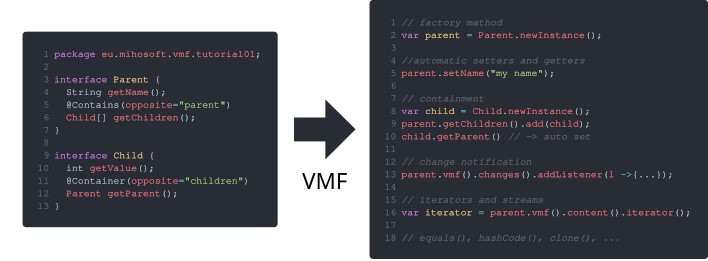

VMF
=======

[](https://www.javadoc.io/doc/eu.mihosoft.vmf/vmf) [](https://www.javadoc.io/doc/eu.mihosoft.vmf/vmf-runtime) [](https://www.javadoc.io/doc/eu.mihosoft.vmf/vmf-jackson)

[](https://gitter.im/VMF_/Lobby?utm_source=badge&utm_medium=badge&utm_campaign=pr-badge&utm_content=badge)
<a href="https://foojay.io/today/works-with-openjdk">
   
</a>

<br>


VMF is a lightweight modeling framework. It conveniently translates annotated Java interfaces into powerful implementations. It writes all the inevitable but boring boilerplate code for you and provides a modern and stable API. It is designed to work with the newest versions of Java as soon as they are released. It works well with Java 11-24.
It generates/supports:

- getters and setters
- default values
- containment
- builder API
- equals() and hashCode()
- deep and shallow cloning
- [change notification and observer scopes](docs/observing-models.md)
- undo/redo
- [portable change journals in JSON, YAML, and XML](docs/change-journal.md)
- object graph traversal API via iterators and streams
- immutable types and read-only wrappers
- delegation
- annotations
- reflection
- [collection properties, UML multiplicity, and keyed relationships](docs/collection-properties.md)
- [managed map properties](docs/typed-model-properties.md)
- [generic model interfaces and inherited relationships](docs/generic-model-interfaces.md)
- [Jackson serialization for existing JSON and reference-aware JSON, YAML, and XML](jackson/README.md)
- json schema generation for validation and automatic visual editor generation
- ...

A VMF model consists of annotated Java interfaces. We could call this "wannabe" code. Just specify the interface and its properties and get a fully functional  implementation including property setters and getters, builders, iterators, and much more. Even for a simple model VMF provides a lot of useful APIs:



## Using VMF

Checkout the tutorial projects: https://github.com/miho/VMF-Tutorials

VMF comes with excellent Gradle support. Just add the plugin like so (get the latest version [here](https://plugins.gradle.org/plugin/eu.mihosoft.vmf)):

```gradle
plugins {
  id "eu.mihosoft.vmf" version "0.4.0"
}
```

Now just add the model definitions to the VMF source folder, e.g., `src/main/vmf/`. The package name must end with `.vmfmodel`, for example:

```java
package eu.mihosoft.vmf.tutorial.vmfmodel;

import eu.mihosoft.vmf.core.Container;
import eu.mihosoft.vmf.core.Contains;

interface Parent {

    @Contains(opposite = "parent")
    Child[] getChildren();

    String getName();
}

interface Child {
    @Container(opposite="children")
    Parent getParent();
    
    int getValue();
}
```

Just call the `vmfGenModelSources` task to generate the implementation.

See [Generic model interfaces](docs/generic-model-interfaces.md) for reusable property declarations with named concrete bindings.

To improve IDE support, enable the IntelliJ support via

```
buildscript {
  ext.vmfPluginIntelliJIntegration = true
}
```

### Saving plugin features

Register the core and plugin models in a `ModelRegistry`. Once the plugins have
attached their VMF objects, use the codec from `vmf-jackson` to save and reload
the owner and its directly attached features in one file. Use a `.json`, `.yaml`,
`.yml`, or `.xml` filename, or pass the shared `VMFDocumentFormat` explicitly.
A filename without an extension uses JSON. Unrecognized extensions require an explicit format.

```java
var codec = new VMFFeatureCodec(registry);
codec.save(path, device, attachments);

var loaded = codec.load(path, Device.class);
Device restored = loaded.owner();
var calibration = loaded.attachments().find(restored, Calibration.class);
```

The codec handles modeled properties for each registered feature type. If a
plugin required by the file is missing, loading reports its type name.
[See the two-plugin example.](jackson/src/test/java/eu/mihosoft/vmf/jackson/test/plugincomposition/PluginCompositionExampleTest.java)

### Snapshots

Between releases, `main` is published as `-SNAPSHOT` (e.g. `0.4.0-SNAPSHOT`) to the Maven Central snapshot repository. To use it, add the repository for plugins (`settings.gradle`) and, for other VMF artifacts such as `vmf-jackson`, for dependencies:

```gradle
// settings.gradle
pluginManagement {
  repositories {
    maven {
      url = uri('https://central.sonatype.com/repository/maven-snapshots/')
      mavenContent { snapshotsOnly() }
    }
    gradlePluginPortal()
    mavenCentral()
  }
}
```

```gradle
// build.gradle
plugins {
  id "eu.mihosoft.vmf" version "0.4.0-SNAPSHOT"
}

repositories {
  mavenCentral()
  maven {
    url = uri('https://central.sonatype.com/repository/maven-snapshots/')
    mavenContent { snapshotsOnly() }
  }
}
```

Snapshots change without notice and are deleted after 90 days; Gradle caches them for 24 hours (`--refresh-dependencies` fetches the latest). How snapshots and releases are published: [docs/RELEASING.md](docs/RELEASING.md).

## Building VMF (Core, Runtime and Plugin)

### Requirements

- Install JDK 11 and JDK 17. Set `JAVA_HOME` to the JDK that runs Gradle. CI uses JDK 17, 21 and 24.
- Install Maven (`mvn` on your path) to run the full build.
- The first build downloads dependencies.
- IDE: [Gradle](http://www.gradle.org/) Plugin (not necessary for command line usage)

### IDE

Open the `VMF` [Gradle](http://www.gradle.org/) project in your favourite IDE (tested with IntelliJ 2024) and build it
by executing the `publishToMavenLocal` task.

### Command Line

Navigate to the `VMF`[Gradle](http://www.gradle.org/) project (i.e., `path/to/VMF/`) and enter the following command

#### Bash (Linux/macOS/Cygwin/other Unix shell)

    bash gradlew publishToMavenLocal
    
#### Windows (CMD)

    gradlew publishToMavenLocal
    
> **NOTE:** to execute the tests within the VMF project (basic tests) execute the `test` task after executing `publishToMavenLocal`.    
    
    
## Testing VMF

From the repository root, run `sh ./build-and-test-all.sh` on Linux or macOS, or
`build-and-test-all.bat` on Windows. These are the same commands that CI uses.
They build VMF into your local Maven repository and test the generator, both
build plugins, generated models and Jackson integration.

Once dependencies are cached, append `--offline` to either command. This lets
you run the full suite during a repository outage without requesting dependencies
or publishing artifacts to Maven Central.

### Viewing the Report

An HTML version of the test report is located in the build folder `test-suite/build/reports/tests/test/index.html`.

### Local performance verification

Run the [local performance gate](test-suite/PERFORMANCE.md) to check containment, events, recording, and replay against a saved machine-local baseline.
